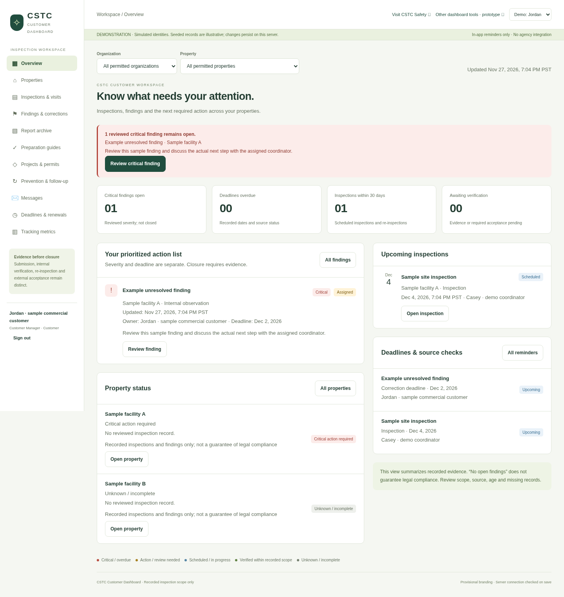
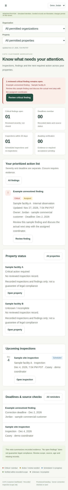

# Inspection screen guide

These screenshots are generated from isolated demonstration records, not actual CSTC inspection results.

The organization/property selectors establish scope. A reviewed critical condition receives the first action and red label. Summary cards separate urgency, overdue dates, upcoming visits and pending evidence. The action list shows owner, deadline, latest update and next step; the schedule stays alongside it. Property status explicitly shows missing reviewed records. The visible demonstration banner and provisional-branding footer prevent fictional data from appearing verified.

On a small screen, the navigation collapses behind a labeled menu and panels stack. Labels accompany colors. Calendar entries have keyboard-accessible buttons and a list-view alternative; wide tables/calendar grids scroll inside their containers.

## Workflow screens

- **Inspection:** scope/source, verified or unverified inspector identity, customer confirmation, local appointment time with explicit zone, preparation guide/checklist/owner deadlines, original report and revisions, resulting findings, comments.
- **Finding:** immutable source record and original deadline on the left; correction submission/review history below; independent review, required re-inspection, documentary acceptance and closure on the right. Disputes and extensions preserve source history. File access remains server-authorized.
- **Proof dialog:** recover the author’s saved server draft, upload permitted files, save without submission or send for independent review. Confirmation and failures are visible. Offline saving is unavailable.
- **Reports:** search the archive and open the corresponding inspection to move to findings, evidence and linked re-inspection. Pending files remain blocked for customers; reviewed versions remain traceable.
- **Projects & permits:** job scope and jurisdiction first; potential applicability, official source, owner, recorded application, issued document, conditions and expiration below. An application is never an issued permit.
- **Reminders:** recorded date, zone, owner and source-review status for inspections, corrections, preparation milestones, permits, credentials and tasks. Actual delivery remains in-app only.
- **Tracking metrics:** pending/active/closed workload with record drilldown; inspection windows and timing medians with definitions, date cohort, source timestamp, missing-data handling and CSV export.
- **Team:** administrator provisioning of organizations, scoped roles and qualification, disabling accounts and session-revoking password resets. Shared mode uses passwords; demo mode’s picker is explicitly simulated.
